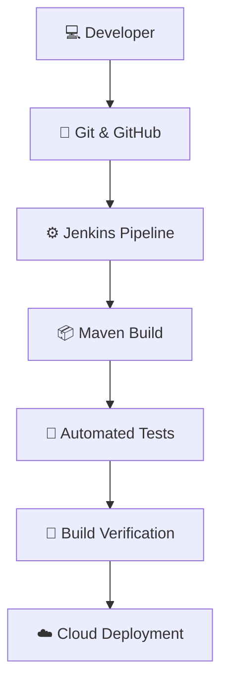

# Nayan Pimaple
# 👋 Hi, I'm Nayan Pimpale

<div align="center">


### 🚀 Aspiring DevOps & Cloud Engineer

*Turning ideas into automation. Learning today, building tomorrow.*


<a href="https://github.com/NayanPimpale">

</a>

</div>

---

## 🧑‍🚀 About Me

Hey there! I'm **Nayan Pimpale**, a Computer Engineering graduate from Wardha, Maharashtra, India.

I'm passionate about **DevOps, Cloud Computing, and Automation**. I enjoy exploring new technologies, working with cloud infrastructure, and learning how to automate development workflows.

- 🎓 B.Tech in Computer Engineering
- ☁️ Exploring AWS Cloud Services
- ⚙️ Practicing CI/CD with Jenkins and Maven
- 🐧 Working with Linux and Ubuntu
- 🔗 Learning Git and GitHub
- 🚀 Exploring Docker and DevOps tools
- 🎯 Goal: Become a skilled DevOps and Cloud Engineer

```bash
┌──[ nayan@devops ]──[~]
│
├── name       : Nayan Pimpale
├── role       : Aspiring DevOps Engineer
├── education  : B.Tech Computer Engineering
├── location   : Maharashtra, India
├── experience : Fresher
│
├── interests  :
│   ├── Cloud Computing
│   ├── DevOps Engineering
│   ├── CI/CD Automation
│   └── Infrastructure
│
└── status     : Building. Learning. Automating.
```

---

## ⚡ My Tech Universe

<div align="center">

### ☁️ Cloud & Infrastructure


### 🔄 DevOps & Version Control


### 💻 Programming & Database


</div>

---

## 🧩 Technology Stack

| Domain | Technologies |
|---|---|
| Cloud | AWS, EC2 fundamentals |
| Operating Systems | Linux, Ubuntu, Windows |
| Version Control | Git, GitHub |
| CI/CD | Jenkins, Maven |
| Containers | Docker (learning) |
| Programming | Java, Python |
| Database | SQL, MySQL |

---

## 🔥 My DevOps Workflow

<div align="center">



**Automate the process. Simplify the workflow. Build better systems.**

</div>

---

## 🚀 Projects & Hands-on Practice

### 01. Spring PetClinic – Maven CI Pipeline


**Technologies:** Java · Maven · GitHub · Jenkins

- Integrated a GitHub repository with Jenkins.
- Created a Declarative Jenkins Pipeline.
- Practiced Maven validation and compilation.
- Automated build and verification stages.

🔗 [View Project Repository](https://github.com/NayanPimpale/spring-framework-petclinic)

### 02. AWS EC2 – Cloud Server Practice


**Technologies:** AWS · EC2 · Ubuntu · SSH

- Practiced launching EC2 instances.
- Connected to Ubuntu servers using SSH.
- Executed Linux commands on cloud servers.
- Explored basic cloud server administration.

### 03. Jenkins – CI/CD Pipeline Practice


**Technologies:** Jenkins · Git · Maven

- Created Jenkins Declarative Pipelines.
- Connected source code repositories.
- Automated Maven build stages.
- Explored continuous integration workflows.

---

## 📡 Currently Exploring

<div align="center">


</div>

- AWS cloud services and infrastructure
- Jenkins pipeline automation
- Docker and containerization
- Linux server administration
- Maven build management
- DevOps tools and practices

---

## 📊 GitHub Command Center

<div align="center">


</div>

---

## 🤝 Connect With Me

I'm always interested in learning, collaborating, and building exciting technology projects.

<div align="center">

<a href="https://github.com/NayanPimpale">

</a>

<br/><br/>

### 🌌 THINK BIG. AUTOMATE EVERYTHING. KEEP BUILDING.


</div>

