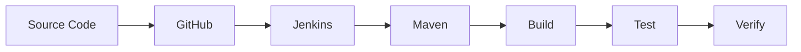

# Nayan-Pimpale
# 👋 Hi, I'm Nayan Pimpale

<div align="center">


### 🚀 Aspiring DevOps & Cloud Engineer | Computer Engineering Graduate

**Learning • Building • Automating • Growing**


<a href="https://github.com/NayanPimpale">

</a>

</div>

---

## 👨‍💻 About Me

Hello! I'm **Nayan Pimpale**, a Computer Engineering graduate from Wardha, Maharashtra, India.

I'm an aspiring IT professional interested in DevOps, Cloud Computing.

I enjoy learning new technologies, solving technical problems and building practical projects.

- 🎓 B.Tech in Computer Engineering
- ☁️ Learning AWS Cloud Computing
- 🔄 Practicing CI/CD using Jenkins and Maven
- 🐧 Learning Linux commands and administration
- 🛠️ Exploring Git and GitHub
- 💻 Interested in DevOps and Software Testing
- 🎯 Goal: To build a successful career in the IT industry

```bash
$ whoami
Nayan Pimpale

$ cat profile.yml

role:       Aspiring DevOps Engineer
education:  B.Tech Computer Engineering
location:   Wardha, Maharashtra, India
experience: Fresher

interests:
  - Cloud Computing
  - DevOps
  - Software Testing
  - Automation
  - CI/CD

status: Learning and building projects
```

---

## 🛠️ Technical Skills

<div align="center">


</div>

| Category | Technologies |
|---|---|
| Cloud | AWS (EC2 fundamentals) |
| Operating Systems | Linux, Ubuntu, Windows |
| Version Control | Git, GitHub |
| CI/CD | Jenkins, Maven |
| Programming | Java, Python |
| Database | SQL, MySQL |
| Learning Areas | DevOps, Cloud, Software Testing |

---

## 🔄 DevOps Learning Journey

My current learning workflow:



I'm learning how to automate software build and testing processes using Jenkins and Maven.

---

## 🚀 Projects & Practice

### 1. Spring PetClinic Maven CI Pipeline

**Technologies:** GitHub | Jenkins | Maven | Java

- Integrating GitHub with Jenkins.
- Checking project validation.
- Compiling Java source code.
- Running unit tests.
- Verifying and installing the Maven project.

[View Spring PetClinic Repository](https://github.com/NayanPimpale/spring-framework-petclinic)

### 2. AWS EC2 Practice

**Technologies:** AWS | EC2 | Ubuntu | Linux

- Learning how to launch EC2 instances.
- Connecting to Ubuntu instances using SSH.
- Practicing Linux commands.
- Understanding cloud server fundamentals.

### 3. Jenkins CI/CD Practice

**Technologies:** Jenkins | Git | Maven

- Creating Jenkins declarative pipelines.
- Integrating source code repositories.
- Automating Maven build stages.
- Understanding continuous integration.

---

## 📚 Currently Learning

<div align="center">


</div>

- AWS services and cloud infrastructure
- Jenkins pipeline automation
- Docker and containerization
- Linux administration
- DevOps tools and practices
- Software Testing fundamentals

---

## 📊 GitHub Analytics

<div align="center">


</div>

---

## 🤝 Let's Connect

I'm interested in learning, collaborating and working on practical IT projects.

<a href="https://github.com/NayanPimpale">

</a>

<div align="center">

### ⭐ Learn Every Day. Build Every Day. Grow Every Day.


</div>
